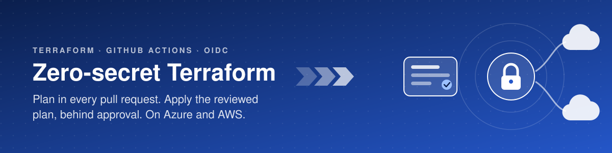
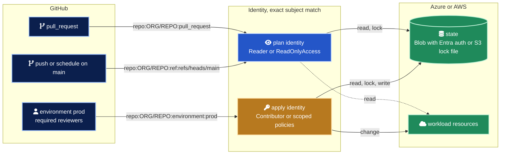
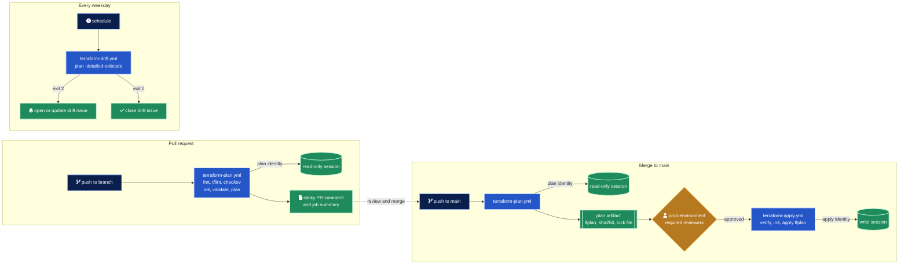
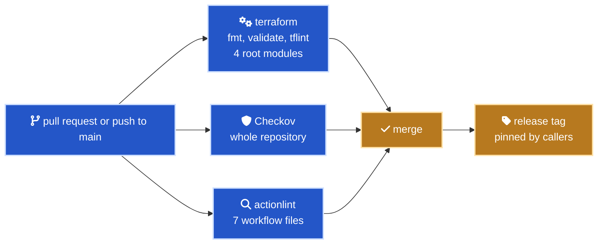

<div align="center">



# Terraform on GitHub Actions with OIDC

Reusable workflows that plan, apply and watch Terraform on Azure and AWS without a single stored cloud credential.<br>
Pull requests get a reviewed plan. Production gets exactly that plan, after a human approves it.

[](https://github.com/marlyngiselle/terraform-github-actions-oidc/actions/workflows/ci.yml)
[](bootstrap)
[](bootstrap/azure)
[](bootstrap/aws)
[](docs/security-model.md)
[](docs/security-model.md#4-environment-protection-is-what-makes-environmentprod-meaningful)
[](LICENSE)

</div>

## In numbers

| | |
| ---: | --- |
| 0 | Cloud secrets stored in GitHub. Every session is minted per job and expires in about an hour |
| 3 | Reusable workflows, plan, apply and drift |
| 2 | Clouds, Azure and AWS, behind the same inputs |
| 2 | Identities per cloud, read-only for plans and write for applies |
| 3 | Exact OIDC subjects trusted per cloud, no wildcards |
| 19 | Workflow inputs, all documented in the workflow files |
| 2 | Bootstrap root modules, 10 Azure and 11 AWS resource blocks |
| 3 | Caller workflows ready to copy, plus 2 demo root modules |
| 9 | Security controls, each tied to the threat it closes |

## What it is

The usual way to let a pipeline deploy infrastructure is a client secret or an access key stored as a repository secret. It works from anywhere, lives until someone rotates it, is shared by every job, and turns every leaked log line into an incident.

This repository replaces it with identity. A job proves who it is with a token signed by GitHub, and the cloud decides what that identity can do. Plans run with a read-only identity in every pull request. Applies run with a write identity that only a protected `prod` environment can reach, and they apply the exact plan a reviewer approved.

It is for platform teams that want one hardened, reusable path to production for every Terraform repository they own.

## Architecture



In the subjects above, `ORG/REPO` is the consuming repository, the one that holds your Terraform code and calls these workflows. The token exchange step by step is in [docs/oidc-flow.md](docs/oidc-flow.md).

## How it flows



| Concern | How it is handled |
| --- | --- |
| Authentication | GitHub OIDC tokens exchanged for cloud sessions of about one hour |
| Blast radius | Two identities per cloud, read-only for plans, write for applies |
| Who can deploy | The write identity trusts only `environment:prod`, protected by required reviewers and a `main`-only branch rule |
| What gets deployed | The apply job uses the saved plan artifact, verified by commit and SHA-256 |
| Quality gates | `terraform fmt`, `validate`, TFLint and Checkov run before any credential exists in the job |
| Visibility | Plan posted as a sticky pull request comment and as the job summary |
| Drift | Scheduled plan with `-detailed-exitcode` opens, updates or closes one issue per root module |
| State | Azure Blob with Entra ID auth only (keys disabled), or S3 with native lock file. Versioned, encrypted, delete-protected |

## Quick start

You need Terraform 1.10 or later, the Azure CLI signed in with rights to create app registrations and role assignments, the GitHub CLI signed in, and admin rights on the repository that holds your Terraform code. Run every command from the root of that repository.

```bash
INFRA_REPO="$(gh repo view --json nameWithOwner --jq .nameWithOwner)"
git clone https://github.com/marlyngiselle/terraform-github-actions-oidc.git "$HOME/terraform-github-actions-oidc"
BOOT="$HOME/terraform-github-actions-oidc/bootstrap/azure"

terraform -chdir="$BOOT" init
terraform -chdir="$BOOT" apply \
  -var "tenant_id=$(az account show --query tenantId --output tsv)" \
  -var "subscription_id=$(az account show --query id --output tsv)" \
  -var "github_owner=${INFRA_REPO%/*}" \
  -var "github_repository=${INFRA_REPO#*/}"

terraform -chdir="$BOOT" output -raw github_cli_commands | sh

mkdir -p infra/azure .github/workflows
cp "$HOME"/terraform-github-actions-oidc/examples/infra/azure/*.tf infra/azure/
terraform -chdir="$BOOT" output -raw backend_config | sed 's#CHANGE-ME#infra/azure#' > infra/azure/backend.hcl
cp "$HOME/terraform-github-actions-oidc/examples/workflows/azure-terraform.yml" .github/workflows/
```

That creates the two identities and the state account, registers the identifiers as GitHub variables (variables, not secrets), and drops a demo root module and its caller workflow in place. For AWS, the same steps use [`bootstrap/aws`](bootstrap/aws), [`examples/infra/aws`](examples/infra/aws) and [`aws-terraform.yml`](examples/workflows/aws-terraform.yml).

Then, in the repository settings, create the `prod` environment with required reviewers, prevent self-review enabled and deployment branches limited to `main`. Open a pull request and the plan appears as a comment.

The caller workflow points at this repository.

```yaml
jobs:
  plan:
    uses: marlyngiselle/terraform-github-actions-oidc/.github/workflows/terraform-plan.yml@v1
    permissions: { contents: read, id-token: write, pull-requests: write }
    with:
      provider: azure
      working-directory: infra/azure
      azure-client-id: ${{ vars.AZURE_PLAN_CLIENT_ID }}
      azure-tenant-id: ${{ vars.AZURE_TENANT_ID }}
      azure-subscription-id: ${{ vars.AZURE_SUBSCRIPTION_ID }}
```

## Access model

| | Plan identity | Apply identity |
| --- | --- | --- |
| Trusted subjects | `pull_request`, `ref:refs/heads/main` | `environment:prod` only |
| Azure role | `Reader` on the deployment scope | `Contributor` on the deployment scope |
| AWS policy | `ReadOnlyAccess` | Policies passed in `apply_policy_arns` |
| State access | Read and lock | Read, lock and write |
| Reachable by | Any pull request from the repository, scheduled drift checks | Approved jobs in the `prod` environment |

| Job context | `sub` claim | Identity it can obtain |
| --- | --- | --- |
| Pull request from the same repository | `repo:ORG/REPO:pull_request` | plan |
| Push or schedule on `main` | `repo:ORG/REPO:ref:refs/heads/main` | plan |
| Job with `environment: prod` | `repo:ORG/REPO:environment:prod` | apply |
| Push to any other branch | `repo:ORG/REPO:ref:refs/heads/<branch>` | none |
| Pull request from a fork | no token is issued | none |

| GitHub token permission | plan | apply | drift |
| --- | :---: | :---: | :---: |
| `contents` | read | read | read |
| `id-token` | write | write | write |
| `pull-requests` | write | | |
| `issues` | | | write |

Every reusable workflow starts from `permissions: {}` and checks out with `persist-credentials: false`. The full model, control by control, is in [docs/security-model.md](docs/security-model.md).

## Delivery of this repository



[`ci.yml`](.github/workflows/ci.yml) needs no cloud access. Merging and tagging a release are manual. The same checks run locally.

```bash
pre-commit install
terraform fmt -recursive
for dir in bootstrap/azure bootstrap/aws examples/infra/azure examples/infra/aws; do
  terraform -chdir="$dir" init -backend=false -input=false
  terraform -chdir="$dir" validate
  tflint --chdir="$dir" --config "$PWD/.tflint.hcl"
done
checkov -d . --framework terraform,github_actions --quiet
actionlint .github/workflows/*.yml examples/workflows/*.yml
```

## Before you touch anything

> [!CAUTION]
> The `environment:prod` subject is only as strong as the rules on the `prod` environment. Configure required reviewers and the `main`-only branch rule before the apply client ID or role ARN goes anywhere.

> [!WARNING]
> A saved plan can contain sensitive values in clear text. Plan artifacts are uploaded only when there are changes and kept for 5 days by default. Prefer private infrastructure repositories.

> [!IMPORTANT]
> Plan and apply must use the same `terraform-version`, and the committed `.terraform.lock.hcl` must cover the runner platform, because the apply runs `terraform init -lockfile=readonly`.

> [!NOTE]
> The bootstrap keeps its own state locally, in `bootstrap/azure` or `bootstrap/aws`. Keep that state somewhere safe, it owns the identities and the state account.

> [!TIP]
> A called workflow can never gain permissions its caller did not grant. If the token is never issued, grant `id-token: write` on the calling job. Fork pull requests never get a token, by design.

## Reference

| Workflow | Trigger in the caller | Identity |
| --- | --- | --- |
| [`terraform-plan.yml`](.github/workflows/terraform-plan.yml) | `pull_request`, `push` to `main` | plan |
| [`terraform-apply.yml`](.github/workflows/terraform-apply.yml) | after plan, on `push` to `main` | apply |
| [`terraform-drift.yml`](.github/workflows/terraform-drift.yml) | `schedule`, `workflow_dispatch` | plan |

<details>
<summary>Inputs</summary>

| Input | plan | apply | drift | Default | Description |
| --- | :---: | :---: | :---: | --- | --- |
| `provider` | required | required | required | | `azure` or `aws` |
| `working-directory` | required | required | required | | Terraform root module path |
| `environment` | | required | | | GitHub Environment gating the apply |
| `plan-artifact` | | required | | | `plan-artifact` output of the plan job |
| `terraform-version` | yes | yes | yes | `1.16.7` | Same value for plan and apply |
| `backend-config` | yes | yes | yes | `backend.hcl` | Relative to `working-directory`, empty to skip |
| `var-file` | yes | | yes | | Optional tfvars file |
| `azure-client-id` | yes | yes | yes | | Plan or apply application client ID |
| `azure-tenant-id` | yes | yes | yes | | Entra ID tenant |
| `azure-subscription-id` | yes | yes | yes | | Target subscription |
| `aws-role-arn` | yes | yes | yes | | Plan or apply role ARN |
| `aws-region` | yes | yes | yes | | Session region |
| `tflint-config` | yes | | | `.tflint.hcl` | Skipped if the file is absent |
| `checkov-skip-checks` | yes | | | | Comma-separated check IDs |
| `checkov-soft-fail` | yes | | | `false` | Report without failing |
| `artifact-retention-days` | yes | | | `5` | Plans can hold sensitive values |
| `issue-label` | | | yes | `drift` | Label for drift issues |
| `runs-on` | yes | yes | yes | `ubuntu-latest` | Runner label |
| `timeout-minutes` | yes | yes | yes | `30` / `60` / `30` | Job timeout |

</details>

<details>
<summary>Outputs</summary>

| Workflow | Output | Meaning |
| --- | --- | --- |
| plan | `has-changes` | `"true"` when the plan has changes |
| plan | `plan-artifact` | Artifact name to pass to the apply workflow |
| plan | `plan-exitcode` | `0` no changes, `2` changes |
| drift | `drift-detected` | `"true"` when drift was found |

</details>

<details>
<summary>GitHub variables</summary>

| GitHub variable | Holds | Used by |
| --- | --- | --- |
| `AZURE_TENANT_ID` | Entra ID tenant GUID | all Azure jobs |
| `AZURE_SUBSCRIPTION_ID` | Subscription GUID | all Azure jobs |
| `AZURE_PLAN_CLIENT_ID` | Plan application client ID | plan, drift |
| `AZURE_APPLY_CLIENT_ID` | Apply application client ID | apply |
| `AWS_REGION` | Region, for example `eu-west-1` | all AWS jobs |
| `AWS_PLAN_ROLE_ARN` | `arn:aws:iam::<account>:role/tfgha-github-REPO-plan` | plan, drift |
| `AWS_APPLY_ROLE_ARN` | `arn:aws:iam::<account>:role/tfgha-github-REPO-apply` | apply |

None of them is a secret. They identify resources and grant nothing. The apply client ID is harmless in a pull request, because Entra ID and STS only accept it with a token whose subject is `environment:prod`.

</details>

## Design principles

1. Identity over secrets. Every cloud session is minted per job from a signed token and expires on its own.
2. Read in pull requests, write behind approval. Unreviewed code only ever runs with a read-only identity.
3. Apply what was reviewed. The binary plan travels from plan to apply as a verified artifact, nothing is re-planned at apply time.
4. Fail before touching the cloud. Formatting, linting and policy checks run before the login step.
5. Least privilege everywhere. `permissions: {}` at workflow level, per-job grants, exact OIDC subjects, state access scoped to one container or bucket.
6. Self-contained reusable workflows. No local composite actions, because a `./` path in a called workflow resolves against the caller's checkout.
7. Boring, pinned tooling. Versions are explicit, Dependabot proposes upgrades, CI proves them.

## Repository map

| Path | Role |
| --- | --- |
| [`.github/workflows/terraform-plan.yml`](.github/workflows/terraform-plan.yml) | Reusable. Checks, plan, artifact, PR comment |
| [`.github/workflows/terraform-apply.yml`](.github/workflows/terraform-apply.yml) | Reusable. Verified apply behind an environment |
| [`.github/workflows/terraform-drift.yml`](.github/workflows/terraform-drift.yml) | Reusable. Scheduled plan and drift issue |
| [`.github/workflows/ci.yml`](.github/workflows/ci.yml) | Self-check of this repository |
| [`bootstrap/azure`](bootstrap/azure) | Entra ID apps, federated credentials, RBAC, state account |
| [`bootstrap/aws`](bootstrap/aws) | OIDC provider, IAM roles, S3 state bucket |
| [`examples/infra`](examples/infra) | Demo root modules, a storage account on Azure and an S3 bucket on AWS |
| [`examples/workflows`](examples/workflows) | Caller workflows to copy into an infrastructure repository |
| [`docs`](docs) | OIDC flow, security model, troubleshooting |

## Documentation

| Document | Covers |
| --- | --- |
| [How OIDC authentication works here](docs/oidc-flow.md) | The token exchange, the claims, where trust is defined on each cloud |
| [Security model](docs/security-model.md) | Nine controls and the threat each one closes, plus hardening beyond the baseline |
| [Troubleshooting](docs/troubleshooting.md) | Errors by symptom, with cause and fix |

<div align="center">
<br>
<sub>MIT licensed · © 2026 Giselle Da Costa</sub>
</div>
