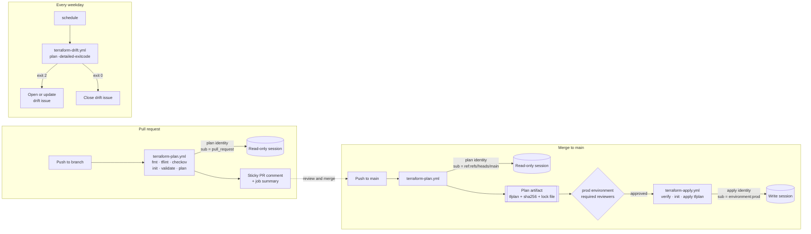

# Terraform on GitHub Actions with OIDC

Reusable GitHub Actions workflows that plan, apply and watch Terraform on Azure and AWS
without a single stored cloud credential. Pull requests get a reviewed plan, production gets
exactly that plan after a human approves it, and a scheduled job opens an issue when reality
drifts from code.

[](.github/workflows/ci.yml)


[](LICENSE)

## The problem

The usual way to let a pipeline deploy infrastructure is a client secret or an access key
stored as a repository secret. That credential:

- works from anywhere, for anyone who copies it,
- lives until someone remembers to rotate it,
- is shared by every job, so a pull request can often do what a production deployment does,
- turns every leaked log line or compromised dependency into an incident.

## The solution

| Concern | How it is handled |
| --- | --- |
| Authentication | GitHub OIDC tokens exchanged for cloud sessions of about one hour. No secrets in GitHub |
| Blast radius | Two identities per cloud: read-only for plans, write for applies |
| Who can deploy | The write identity trusts only `environment:prod`, protected by required reviewers and a `main`-only branch rule |
| What gets deployed | The apply job uses the saved plan artifact, verified by commit and SHA-256 |
| Quality gates | `terraform fmt`, `validate`, TFLint and Checkov run before any credential exists in the job |
| Visibility | Plan posted as a sticky pull request comment and as the job summary |
| Drift | Scheduled plan with `-detailed-exitcode` opens, updates or closes one issue per root module |
| State | Azure Blob with Entra ID auth only (keys disabled), or S3 with native lock file. Versioned, encrypted, delete-protected |

## How it flows



The token exchange itself is detailed in [docs/oidc-flow.md](docs/oidc-flow.md).

## Quick start

You need: Terraform 1.10 or later, permission to create app registrations and role
assignments (Azure) or IAM roles (AWS), and admin rights on the GitHub repository.

**1. Create the identities and the state backend** (runs once, from your machine)

```bash
cd bootstrap/azure            # or bootstrap/aws
cp terraform.tfvars.example terraform.tfvars   # set ORG, REPO and IDs
terraform init
terraform apply
```

**2. Register the identifiers as GitHub variables** (variables, not secrets)

```bash
terraform output -raw github_cli_commands | sh
```

**3. Create and protect the `prod` environment**

Repository settings, Environments, `prod`: add required reviewers, enable prevent
self-review, and limit deployment branches to `main`. This is the control that gives the
apply identity its meaning; see [docs/security-model.md](docs/security-model.md#4-environment-protection-is-what-makes-environmentprod-meaningful).

**4. Point your root module at the backend**

```bash
terraform output -raw backend_config > ../../examples/infra/azure/backend.hcl   # then set key
```

**5. Add a caller workflow**

Copy [`examples/workflows/azure-terraform.yml`](examples/workflows/azure-terraform.yml) (or the
AWS or drift variant) into `.github/workflows/` of the repository that holds your Terraform
code. Replace `ORG/REPO` with the location of these reusable workflows and `@v1` with the
tag you release. Open a pull request and the plan appears as a comment.

```yaml
jobs:
  plan:
    uses: ORG/REPO/.github/workflows/terraform-plan.yml@v1
    permissions: { contents: read, id-token: write, pull-requests: write }
    with:
      provider: azure
      working-directory: infra/azure
      azure-client-id: ${{ vars.AZURE_PLAN_CLIENT_ID }}
      azure-tenant-id: ${{ vars.AZURE_TENANT_ID }}
      azure-subscription-id: ${{ vars.AZURE_SUBSCRIPTION_ID }}
```

## Reusable workflows

| Workflow | Trigger in the caller | Job permissions | Identity |
| --- | --- | --- | --- |
| [`terraform-plan.yml`](.github/workflows/terraform-plan.yml) | `pull_request`, `push` to `main` | `contents: read`, `id-token: write`, `pull-requests: write` | plan |
| [`terraform-apply.yml`](.github/workflows/terraform-apply.yml) | after plan, on `push` to `main` | `contents: read`, `id-token: write` | apply |
| [`terraform-drift.yml`](.github/workflows/terraform-drift.yml) | `schedule`, `workflow_dispatch` | `contents: read`, `id-token: write`, `issues: write` | plan |

### Inputs

| Input | plan | apply | drift | Default | Description |
| --- | :---: | :---: | :---: | --- | --- |
| `provider` | required | required | required | | `azure` or `aws` |
| `working-directory` | required | required | required | | Terraform root module path |
| `environment` | | required | | | GitHub Environment gating the apply |
| `plan-artifact` | | required | | | `plan-artifact` output of the plan job |
| `terraform-version` | yes | yes | yes | `1.16.7` | Same value for plan and apply |
| `backend-config` | yes | yes | yes | `backend.hcl` | Relative to `working-directory`, empty to skip |
| `var-file` | yes | | yes | | Optional tfvars file |
| `azure-client-id` | yes | yes | yes | | Plan or apply application client ID |
| `azure-tenant-id` | yes | yes | yes | | Entra ID tenant |
| `azure-subscription-id` | yes | yes | yes | | Target subscription |
| `aws-role-arn` | yes | yes | yes | | Plan or apply role ARN |
| `aws-region` | yes | yes | yes | | Session region |
| `tflint-config` | yes | | | `.tflint.hcl` | Skipped if the file is absent |
| `checkov-skip-checks` | yes | | | | Comma-separated check IDs |
| `checkov-soft-fail` | yes | | | `false` | Report without failing |
| `artifact-retention-days` | yes | | | `5` | Plans can hold sensitive values |
| `issue-label` | | | yes | `drift` | Label for drift issues |
| `runs-on` | yes | yes | yes | `ubuntu-latest` | Runner label |
| `timeout-minutes` | yes | yes | yes | `30` / `60` / `30` | Job timeout |

### Outputs

| Workflow | Output | Meaning |
| --- | --- | --- |
| plan | `has-changes` | `"true"` when the plan has changes |
| plan | `plan-artifact` | Artifact name to pass to the apply workflow |
| plan | `plan-exitcode` | `0` no changes, `2` changes |
| drift | `drift-detected` | `"true"` when drift was found |

### Variables and secrets

| GitHub variable | Example value | Used by |
| --- | --- | --- |
| `AZURE_TENANT_ID` | `00000000-0000-0000-0000-000000000000` | all Azure jobs |
| `AZURE_SUBSCRIPTION_ID` | `00000000-0000-0000-0000-000000000000` | all Azure jobs |
| `AZURE_PLAN_CLIENT_ID` | `00000000-0000-0000-0000-000000000000` | plan, drift |
| `AZURE_APPLY_CLIENT_ID` | `00000000-0000-0000-0000-000000000000` | apply |
| `AWS_REGION` | `eu-west-1` | all AWS jobs |
| `AWS_PLAN_ROLE_ARN` | `arn:aws:iam::000000000000:role/tfgha-github-REPO-plan` | plan, drift |
| `AWS_APPLY_ROLE_ARN` | `arn:aws:iam::000000000000:role/tfgha-github-REPO-apply` | apply |

**Secrets: none.** These values identify resources; they do not grant access. The apply
client ID is harmless in a pull request because Entra ID and STS only accept it with a token
whose subject is `environment:prod`.

## Repository layout

```text
.
├── .github/
│   ├── workflows/
│   │   ├── terraform-plan.yml      reusable: checks, plan, artifact, PR comment
│   │   ├── terraform-apply.yml     reusable: verified apply behind an environment
│   │   ├── terraform-drift.yml     reusable: scheduled plan and drift issue
│   │   └── ci.yml                  self-check of this repository
│   └── dependabot.yml
├── bootstrap/
│   ├── azure/                      Entra ID apps, federated credentials, RBAC, state account
│   └── aws/                        OIDC provider, IAM roles, S3 state bucket
├── examples/
│   ├── infra/azure/                demo root module: resource group and storage account
│   ├── infra/aws/                  demo root module: S3 bucket
│   └── workflows/                  caller workflows to copy into an infrastructure repo
├── docs/
│   ├── oidc-flow.md                token exchange, claims, where trust is defined
│   ├── security-model.md           controls and the threat each one closes
│   └── troubleshooting.md          errors by symptom, with fixes
├── .tflint.hcl
└── .pre-commit-config.yaml
```

## Design principles

1. **Identity over secrets.** Every cloud session is minted per job from a signed token, and
   expires on its own.
2. **Read in pull requests, write behind approval.** Unreviewed code only ever runs with a
   read-only identity.
3. **Apply what was reviewed.** The binary plan travels from plan to apply as a verified
   artifact; nothing is re-planned at apply time.
4. **Fail before touching the cloud.** Formatting, linting and policy checks run before the
   login step.
5. **Least privilege everywhere.** `permissions: {}` at workflow level, per-job grants,
   exact OIDC subjects, state access scoped to one container or bucket.
6. **Self-contained reusable workflows.** No local composite actions: a `./` path in a called
   workflow resolves against the caller's checkout, so every step lives in the workflow file.
7. **Boring, pinned tooling.** Versions are explicit, Dependabot proposes upgrades, CI proves
   them.

## Local development

```bash
pre-commit install                     # fmt, validate, tflint, actionlint, gitleaks on commit

terraform fmt -recursive
for dir in bootstrap/azure bootstrap/aws examples/infra/azure examples/infra/aws; do
  terraform -chdir="$dir" init -backend=false -input=false
  terraform -chdir="$dir" validate
  tflint --chdir="$dir" --config "$PWD/.tflint.hcl"
done
checkov -d . --framework terraform,github_actions --quiet
actionlint .github/workflows/*.yml examples/workflows/*.yml
```

The same checks run in [`ci.yml`](.github/workflows/ci.yml) on every pull request.

## Further reading

- [How OIDC authentication works here](docs/oidc-flow.md)
- [Security model](docs/security-model.md)
- [Troubleshooting](docs/troubleshooting.md)

## License

[MIT](LICENSE) © 2026 Giselle Da Costa
