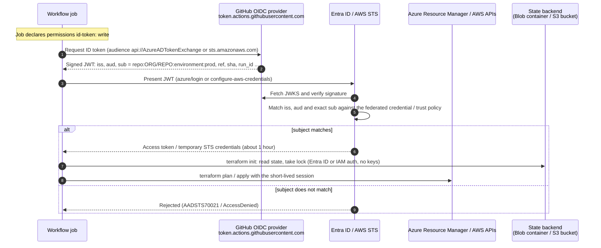

# How OIDC authentication works here

Every job that touches a cloud starts with zero credentials. It asks GitHub for a signed
identity token that describes the job, then trades that token for a cloud session that lasts
about an hour. Nothing long-lived is stored in GitHub, so there is nothing to leak or rotate.

## The exchange, step by step

## What the token says about the job

GitHub builds the `sub` claim from the event that triggered the job. The cloud side trusts
an exact `sub`, so the claim decides which identity a job can become.

| Job context | `sub` claim | Identity it can obtain |
| --- | --- | --- |
| Pull request (any branch, same repository) | `repo:ORG/REPO:pull_request` | plan (read-only) |
| Push or schedule on `main` | `repo:ORG/REPO:ref:refs/heads/main` | plan (read-only) |
| Job with `environment: prod` | `repo:ORG/REPO:environment:prod` | apply (write) |
| Push to any other branch | `repo:ORG/REPO:ref:refs/heads/<branch>` | none |
| Pull request from a fork | no token: fork runs never receive `id-token: write` | none |

When a job declares an `environment`, the environment replaces the ref in the subject.
That is why the apply identity can be tied to the protected environment alone: no branch,
tag or pull request can produce `environment:prod` without passing the environment's
protection rules first.

## Where each piece lives

| Piece | Azure | AWS |
| --- | --- | --- |
| Trust anchor | Federated identity credential on an Entra ID application | IAM OIDC identity provider for `token.actions.githubusercontent.com` |
| Subject check | `subject` field, exact match | `token.actions.githubusercontent.com:sub` condition, `StringEquals` |
| Audience | `api://AzureADTokenExchange` | `sts.amazonaws.com` |
| Session | Entra ID access token for ARM and Storage | STS temporary credentials, `max_session_duration` 1 hour |
| Terraform wiring | `ARM_USE_OIDC=true`, `ARM_CLIENT_ID`, `ARM_TENANT_ID`, `ARM_SUBSCRIPTION_ID` | `AWS_*` variables exported by `configure-aws-credentials` |
| State auth | `use_oidc = true`, `use_azuread_auth = true` | IAM policy on bucket prefix, `use_lockfile = true` |
| Defined in | [`bootstrap/azure`](../bootstrap/azure) | [`bootstrap/aws`](../bootstrap/aws) |

## Why `azure/login` and `ARM_USE_OIDC` both appear

`azure/login` gives the job an authenticated Azure CLI, useful for any `az` step a caller
adds. Terraform does not depend on it: with `ARM_USE_OIDC=true` the azurerm provider and the
azurerm backend request their own GitHub token through `ACTIONS_ID_TOKEN_REQUEST_URL` and
exchange it directly. Each consumer gets a token for the audience it needs, and no token is
written to disk.
